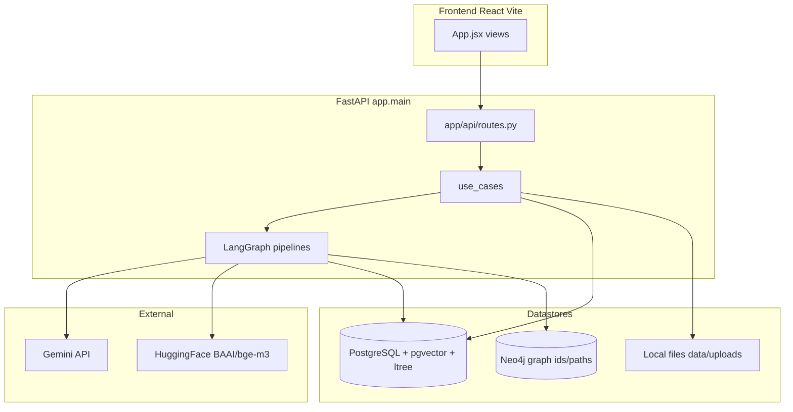
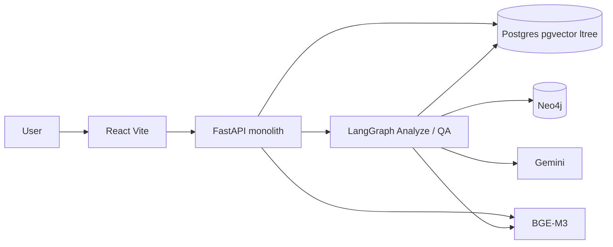

# Project Technical Documentation

Tài liệu này mô tả **repository hiện tại** của đồ án ContractLens. Mọi kết luận đều dựa trên source code, schema, Docker Compose, scripts và tests trong repo. Phần không có evidence thì ghi rõ mức chắc chắn hoặc *Not applicable*.

**Mức chắc chắn dùng trong tài liệu**

| Nhãn | Ý nghĩa |
|------|---------|
| **Implemented** | Có code và có luồng sử dụng thực tế |
| **Configured** | Có cấu hình / biến môi trường; chưa chắc đang bật khi chạy |
| **Referenced** | Có import / khởi tạo / export nhưng không thấy caller trong flow chính |
| **Unused / Dead Code** | Có file hoặc hàm trong repo nhưng không thấy được gọi |
| **Unknown** | Không đủ thông tin trong repo để kết luận |

---

## 1. Project Overview

**Tên project (Implemented):** ContractLens.

Evidence: `app/main.py` (`title="ContractLens"`, `description="Hệ thống AI rà soát hợp đồng tiếng Việt"`, `version="3.0.0"`), `docker-compose.yml` (`name: contractlens`), `README.md`.

**Mục đích (Implemented):** Web app cho phép người dùng đăng ký/đăng nhập, tải hợp đồng tiếng Việt (DOCX/PDF/ảnh), hệ thống trích điều khoản, đối chiếu với kho văn bản pháp luật đã ingest, gắn cờ rủi ro, rồi hỏi đáp trên hợp đồng đó.

**Bài toán (Implemented, nhìn từ code):** rà soát hợp đồng (đặc biệt hợp đồng lao động có nhánh regex/deterministic riêng) so với corpus pháp luật Việt Nam lưu trong PostgreSQL + Neo4j, rồi trả báo cáo rủi ro và Q&A có retrieval.

**Đối tượng sử dụng (Implemented):** người dùng có tài khoản email/mật khẩu. Không có phân quyền admin/role trong schema `users` — chỉ `id`, `email`, `password_hash`, `created_at`. Hợp đồng gắn `user_id`; API kiểm tra ownership qua JWT.

**Thành phần chính (Implemented):**

1. Frontend React (Vite) — UI đăng nhập, danh sách HĐ, upload, báo cáo, chat.
2. Backend FastAPI monolith — auth, upload, analyze, chat.
3. PostgreSQL 16 + pgvector + ltree — user, hợp đồng, chunk/embedding, corpus pháp luật, FTS.
4. Neo4j 5 — cây mục lục + quan hệ văn bản cho GraphRAG expand (không lưu text/embedding).
5. Gemini (Google Generative AI) — LLM.
6. HuggingFace `BAAI/bge-m3` — embedding 1024 chiều.
7. Scripts crawl VBPL + ingest corpus (chạy thủ công, không phải API runtime).

Đây **không** phải microservices. Docker Compose chạy 4 process: `postgres`, `neo4j`, `api`, `frontend`. Backend là một ứng dụng FastAPI.

---

## 2. Main Features

| Feature | Trạng thái | Ghi chú ngắn |
|---------|------------|----------------|
| Đăng ký / đăng nhập JWT | Implemented | Frontend + API |
| Upload hợp đồng, parse, chunk, embed | Implemented | DOCX/PDF/ảnh; `.doc` được accept nhưng parser gọi `python-docx` (cùng nhánh với `.docx`) |
| Phân tích rủi ro (LangGraph) | Implemented | Extract → deterministic pre-pass → LLM per-clause |
| Cache kết quả phân tích | Implemented | JSONB `analysis` / `risks` trên `uploaded_contracts` |
| Human-in-the-loop review | Implemented (API + tests) | Frontend **không** gọi `review_mode` / `/analyze/resume` |
| Hỏi đáp RAG trên HĐ + luật | Implemented | Frontend dùng SSE `/chat/stream` |
| Lịch sử chat | Implemented | Checkpointer Postgres |
| Chat time-travel (states / rewind) | Implemented (API + tests) | Frontend **không** gọi |
| Danh sách hợp đồng theo user | Implemented | |
| Ingest corpus pháp luật | Implemented (scripts) | Không expose REST ingest |
| Crawl vbpl.vn | Implemented (scripts) | Cần `VBPL_COOKIE` |
| Disclaimer AI trên UI | Implemented | `AiDisclaimer.jsx` |

---

## 3. Technology Stack

Chỉ liệt kê dependency **có import/use**. Version Python packages trong `requirements.txt` **không ghim số**; version dưới đây lấy từ Dockerfile / `package.json` / image Compose khi xác định được.

### 3.1 Đang được sử dụng (Implemented)

| Technology | Version (nếu biết) | Dùng ở đâu | Mục đích | Vai trò |
|------------|-------------------|------------|----------|---------|
| Python | 3.12 (image `python:3.12-slim`) | `Dockerfile`, `app/` | Runtime backend | Toàn bộ API, agents, ingest |
| FastAPI | unpinned | `app/main.py`, `app/api/routes.py` | HTTP API | Entry point |
| Uvicorn | unpinned (`uvicorn[standard]`) | `Dockerfile` CMD, `app/main.py` | ASGI server | Chạy API |
| Pydantic / pydantic-settings | unpinned | `app/core/settings.py`, `app/schemas/contract.py` | Settings + response models | Config và API schema |
| React | `^19.2.6` | `frontend/src/` | UI | SPA |
| Vite | `^8.0.12` | `frontend/vite.config.js`, Dockerfile frontend | Dev server / bundler | Frontend runtime (Compose chạy `npm run dev`) |
| Tailwind CSS | `^3.4.19` | `frontend/tailwind.config.js` | Styling | UI |
| PostgreSQL | image `pgvector/pgvector:pg16` | `docker-compose.yml`, `schema.sql` | DB chính | Users, contracts, legal corpus, vectors, FTS |
| pgvector | extension `vector` | `schema.sql`, `app/infrastructure/vector/pg_search.py` | Vector search cosine/HNSW | Embedding HĐ + luật |
| ltree | extension | `schema.sql`, legal paths | Cây Điều/Khoản/Điểm | Key RAG + expand |
| pg_trgm | extension | `schema.sql` | Trigram search số hiệu/tiêu đề | Index `legal_documents` |
| pgcrypto | extension | `schema.sql` | `gen_random_uuid()` | PK `users` |
| Neo4j | image `neo4j:5` | `docker-compose.yml`, `app/infrastructure/neo4j/graph_repository.py` | Graph expand | GraphRAG hydrate (id/path only) |
| psycopg2 | unpinned (`psycopg2-binary`) | `app/infrastructure/db/connection.py` | Sync DB | Repositories, schema apply, vector search |
| psycopg / psycopg_pool | unpinned (`psycopg[binary]`) | `app/agents/checkpointer.py` | Async pool | LangGraph checkpointer + memory store |
| LangGraph | unpinned | `app/agents/workflow.py`, `qa_agent.py` | State graphs | Analyze + QA pipelines |
| langgraph-checkpoint-postgres | unpinned | `app/agents/checkpointer.py` | Persist graph state | Chat history, HITL review |
| langchain-core | unpinned | messages, `Document`, `trim_messages` | Kiểu dữ liệu LangChain | QA, chunker, OCR |
| langchain-google-genai | unpinned | `app/agents/llm_client.py` | Gemini chat | LLM |
| langchain-huggingface | unpinned | `app/infrastructure/embeddings/hf_embedder.py` | Embeddings | BGE-M3 |
| torch | unpinned; Docker cài bản CPU | `hf_embedder.py` (chọn CUDA/CPU) | Runtime embedding | Device cho model |
| google Gemini API | model mặc định `gemini-2.5-flash` | `llm_client.py`, settings | LLM | Extract, judge, QA, OCR ảnh, query rewrite |
| HuggingFace `BAAI/bge-m3` | dim 1024 | settings + embedder | Embedding | Upload HĐ + ingest luật + retrieval |
| PyJWT | unpinned | `app/infrastructure/auth/jwt_tokens.py` | JWT | Auth |
| passlib + bcrypt (`bcrypt<4.1`) | unpinned | `app/infrastructure/auth/password.py` | Hash mật khẩu | Auth |
| python-docx | unpinned | `app/document/parser.py` | Parse DOCX | Upload |
| pdfplumber | unpinned | `app/document/parser.py` | Parse PDF | Upload |
| requests | unpinned | `scripts/crawl_vbpl/` | HTTP crawl | VBPL crawler |
| python-multipart | unpinned | FastAPI upload | Multipart file | `POST /upload` |
| python-dotenv | unpinned | pydantic-settings `env_file=".env"`; `scripts/export_sample_excel.py` | Load env | Config |
| email-validator | unpinned | `EmailStr` trên `AuthRequest` | Validate email | Register/login |
| Docker Compose | file tại root | `docker-compose.yml` | Chạy stack local | postgres + neo4j + api + frontend |
| Node.js | 22 (image `node:22-alpine`) | `frontend/Dockerfile` | Frontend container | Vite |

### 3.2 Có trong `requirements.txt` nhưng không thấy import trực tiếp

| Package | Phân loại | Ghi chú |
|---------|-----------|---------|
| `langchain` (top-level) | Referenced / likely unused trực tiếp | Code import `langchain_core`, `langchain_google_genai`, `langchain_huggingface`, `langgraph` — không có `from langchain import` |
| `langchain-community` | Unused | Không có import |
| `httpx` | Unused | Không có import |
| `numpy` | Unused (trực tiếp) | Không có `import numpy` trong app/scripts/tests |
| `sentence-transformers` | Unknown / có thể transitive | Không import trực tiếp; `HuggingFaceEmbeddings` thường kéo runtime này — **không khẳng định từ source app** |

### 3.3 Script dependency không nằm trong `requirements.txt`

| Package | File | Phân loại |
|---------|------|-----------|
| `openpyxl` | `scripts/export_sample_excel.py` | Implemented trong script; **không** có trong `requirements.txt` |

### 3.4 Không có trong repo (không document như đang dùng)

Không có Redis, Kubernetes, CI/CD (không có `.github/workflows`), không có MinIO/S3 client (storage là local disk). Comment trong `scripts/export_sample_excel.py` viết `storage_key` là “Key lưu trữ (MinIO)” — **không khớp implementation** `LocalObjectStorage`.

LangSmith: biến `LANGCHAIN_TRACING_V2` / `LANGCHAIN_API_KEY` / `LANGCHAIN_PROJECT` có trong `.env.example` và `docker-compose.yml` (**Configured**, tùy chọn). Không có code tự viết client LangSmith.

---

## 4. Project Structure

Cấu trúc thực tế (bỏ `node_modules`, `__pycache__`, `.git`):

```text
contract-agent/
├── app/                          # Backend FastAPI
│   ├── main.py                   # Entry, CORS, lifespan, /health
│   ├── api/                      # Routes + auth dependency
│   ├── application/use_cases/    # Auth, contracts, legal ingest
│   ├── agents/                   # LangGraph analyze + QA + deterministic rules
│   ├── core/                     # settings, prompts, logging
│   ├── document/                 # Parse + chunk hợp đồng
│   ├── domain/                   # Entities, ports, errors
│   ├── infrastructure/           # DB, Neo4j, embeddings, retrieval, auth, storage
│   ├── schemas/                  # Pydantic API/domain DTOs
│   └── vectorstore/              # Facade retrieve_contract / retrieve_legal
├── frontend/                     # React + Vite + Tailwind
├── scripts/                      # Crawl, ingest, restore, backfill, export Excel
│   └── crawl_vbpl/
├── schemas/empty/                # Schema rỗng để dựng DB mới
├── tests/                        # pytest unit + 1 file integration
├── docker/                       # api-entrypoint.sh
├── docs/                         # Tài liệu thiết kế bổ sung (không phải source of truth)
├── data/                         # Runtime uploads / crawl output (gitignore)
├── schema.sql                    # Postgres schema v2.1
├── schema.cypher                 # Neo4j constraints/indexes
├── docker-compose.yml
├── Dockerfile
├── requirements.txt
├── README.md
└── .env.example
```

### Folder quan trọng

| Folder | Việc | Liên kết |
|--------|------|----------|
| `app/api` | HTTP | Gọi use cases |
| `app/application/use_cases` | Orchestrate 1 use case | Gọi ports (repo, pipeline, storage) |
| `app/infrastructure` | Adapter thật | Postgres, Neo4j, HF, Gemini, local files |
| `app/agents` | Logic phân tích + QA | LangGraph; retrieval qua `vectorstore` + `infrastructure/retrieval` |
| `app/infrastructure/legal_corpus` | Parse folder crawl → artifacts ingest | Được `scripts/ingest_*` gọi |
| `app/infrastructure/retrieval` | GraphRAG, rewrite, scope filter | Bind lúc startup trong `main.py` |
| `frontend/src` | UI | `fetch` tới `/api/v1/*` |
| `scripts/` | Offline pipelines | Không đi qua FastAPI (trừ khi tự gọi container) |
| `docs/` | Ghi chú thiết kế/UX | Có thể lệch code; **ưu tiên implementation** |

`app/document/file_handler.py`: **Unused / Dead Code** — không có import từ module khác. Upload thật nằm ở `UploadContract` + `LocalObjectStorage`.

---

## 5. Architecture

Monolith FastAPI + SPA React + 2 datastore.



**Phân tích hợp đồng (rút gọn):**

```text
Frontend
  → POST /api/v1/upload
  → POST /api/v1/analyze
  → AnalyzeContract
  → LangGraphAnalyzePipeline
  → run_analysis_workflow
       extract (LLM + regex)
       evaluate (deterministic labor rules + LLM judge + GraphRAG)
  → save JSONB analysis/risks
  → Frontend
```

**Hỏi đáp:**

```text
Frontend ChatTab
  → POST /api/v1/chat/stream (SSE)
  → LangGraphQaPipeline.stream
  → retrieve (PG hybrid + GraphRAG) → optional rewrite → generate Gemini
  → checkpointer Postgres
  → SSE step/done → UI
```

`LEGAL_EXPAND_BACKEND` (mặc định `neo4j`) chọn expand cây: Neo4j, Postgres ltree, hoặc merge cả hai. **Configured** qua env; code đọc ở `LegalGraphRag._expand`.

---

## 6. Main Application Flows

### 6.1 Đăng ký / đăng nhập

```text
User
→ LoginScreen (signIn / signUp)
→ POST /api/v1/auth/login hoặc /auth/register
→ LoginUser / RegisterUser
→ PgUserRepository + BcryptPasswordHasher + JwtTokenService
→ JSON { access_token, user_id, email }
→ localStorage key contractlens_auth
```

| Bước | File | Function/class | Input | Output |
|------|------|----------------|-------|--------|
| UI | `frontend/src/AuthContext.jsx` | `signIn` / `signUp` | email, password ≥ 6 | token lưu localStorage |
| Route | `app/api/routes.py` | `register` / `login` | `AuthRequest` | token dict |
| Use case | `app/application/use_cases/auth.py` | `RegisterUser` / `LoginUser` | email, password | token |
| DB | `app/infrastructure/db/user_repository.py` | `create` / `get_by_email` | users table | `User` |

Các API còn lại (trừ `/models`, `/health`) lấy user từ header `Authorization: Bearer` → `ResolveUserId` (`app/api/deps.py`).

### 6.2 Upload + index hợp đồng

```text
User chọn file
→ UploadScreen → App.handleSubmit
→ POST /api/v1/upload (multipart)
→ UploadContract.execute
→ LocalObjectStorage.save_upload
→ parse_document
→ chunk_by_clause
→ HuggingFaceEmbedder.embed_documents
→ PgContractRepository.upsert
→ PgContractChunkRepository.replace_for_contract
→ UploadResponse
```

| Bước | File | Function | Input | Processing | Output |
|------|------|----------|-------|------------|--------|
| Save file | `local_storage.py` | `save_upload` | bytes | ghi `UPLOAD_DIR` | storage_key |
| Parse | `document/parser.py` | `parse_document` | path, ext | docx / pdfplumber / Gemini OCR | full_text |
| Chunk | `document/chunker.py` | `chunk_by_clause` | text, contract_id | cắt theo `Điều N`; overlap 120; max 1800 | `Document[]` |
| Embed | `hf_embedder.py` | `embed_documents` | texts | BGE-M3 1024 | vectors |
| Persist | `contract_repository.py` / `contract_chunk_repository.py` | upsert / replace | entities | SQL | rows |

Nếu parse lỗi: vẫn upsert contract `status=uploaded`, `chunk_count=0`.

### 6.3 Phân tích rủi ro

```text
POST /api/v1/analyze { contract_id, provider, force, review_mode }
→ AnalyzeContract.execute
→ nếu đã có analysis và force=false và review_mode=false: trả cache
→ LangGraphAnalyzePipeline.run
→ supervisor: extract → evaluate → (review nếu review_mode) → END
→ save_analysis JSONB
```

**Extract subgraph:** `_extract_node` → `parse_contract` (`clause_parser.py`): regex trước, LLM `EXTRACTION_PROMPT` điền field trống.

**Evaluate subgraph:**

1. `_deterministic_node`: `check_labor_red_flags`, `check_labor_completeness`, `check_preamble_citations`.
2. Fan-out `Send("judge_clause")` cho Điều **không** nằm `skip_llm_clauses`.
3. `_judge_clause_node` → `evaluate_clause` (`risk_flagger.py`): GraphRAG luật → `CLAUSE_RISK_PROMPT` → Gemini JSON → `RiskItem`.

Concurrency: `max_concurrency=2`. Extract retry graph tối đa 2; judge retry trong node tối đa 2.

### 6.4 Chat / Q&A

```text
ChatTab.handleSend
→ POST /api/v1/chat/stream
→ ownership check get_owned
→ stream_answer_events
   retrieve → (rewrite loop ≤ 2) → generate (JSON, retry ≤ 2) → remember
   hoặc refusal nếu hết attempt và không có context
→ SSE event: step | done
```

`POST /api/v1/chat` (non-stream) **Implemented** trên backend; frontend **không gọi** (`chatWithContract` export **Referenced**).

### 6.5 Ingest pháp điển (offline)

```text
Folder crawl (thuoc_tinh.json, van_ban.md, muc_luc.json, optional luoc_do.json)
→ load_document_folder (assemble.py)
→ IngestLegalDocument.execute
→ Postgres legal_* + embeddings
→ Neo4j Document/Node/Chunk tree + doc relations
```

Không có HTTP endpoint ingest.

---

## 7. Frontend

**Framework (Implemented):** React 19, Vite, Tailwind. **Không** có React Router — điều hướng bằng `useState` `view` / `result` trong `App.jsx`.

**Entry:** `frontend/src/main.jsx` → `AuthProvider` → `App`.

**State:** local React state + `AuthContext` + `localStorage` (`contractlens_auth`, sidebar `cl-sidebar-collapsed`). Không Redux/Zustand.

### Screens / components

| Component | File | Việc |
|-----------|------|------|
| `App` | `App.jsx` | Gate auth, list/upload/analysis |
| `LoginScreen` | `LoginScreen.jsx` | Login/register |
| `Sidebar` | `Sidebar.jsx` | Nav Hợp đồng / Tải lên / Báo cáo / Hỏi đáp |
| `ContractListScreen` | `ContractListScreen.jsx` | List + mở HĐ (gọi analyze cache) |
| `UploadScreen` | `UploadScreen.jsx` | Drag-drop, `fetchModels` |
| `AnalysisResult` | `AnalysisResult.jsx` | Tabs report/chat |
| `ExecutiveSummary` | `ExecutiveSummary.jsx` | Tóm tắt số liệu |
| `IssueList` / `IssueCard` | tương ứng | Rủi ro |
| `ContractProfile` | `ContractProfile.jsx` | Metadata extract |
| `ClauseIndex` | `ClauseIndex.jsx` | Mục lục Điều |
| `ChatTab` | `ChatTab.jsx` | History + SSE chat |
| `AiDisclaimer` | `AiDisclaimer.jsx` | Disclaimer |
| `riskDisplay` | `lib/riskDisplay.js` | Normalize/sort/dedupe risk |

### User action → API

```text
Đăng nhập     → AuthContext.signIn      → POST /api/v1/auth/login
Đăng ký       → AuthContext.signUp      → POST /api/v1/auth/register
Tải HĐ        → uploadContract          → POST /api/v1/upload
Phân tích     → analyzeContract         → POST /api/v1/analyze
Mở HĐ cũ      → analyzeContract         → POST /api/v1/analyze (cache nếu có)
Danh sách     → listContracts           → GET  /api/v1/contracts
Chọn model    → fetchModels             → GET  /api/v1/models
Chat          → streamChat              → POST /api/v1/chat/stream
Lịch sử chat  → fetchChatHistory        → GET  /api/v1/chat/{id}/history
Đăng xuất     → localStorage clear      → không gọi API
```

**API base:** `import.meta.env.VITE_API_BASE_URL`. Fallback trong `api.js` / `AuthContext.jsx` là `http://localhost:8000`. Compose và `.env.example` gốc dùng `http://localhost:8010`. `frontend/.env.example` ghi `8000`. Nếu chạy lệch port, frontend có thể gọi nhầm API.

Không có UI cho review HITL, rewind, hay list checkpoint.

---

## 8. Backend

**Framework:** FastAPI.

**Entry:** `app/main.py` — CORS từ `CORS_ORIGINS`, `include_router(router)`, `/health`, optional mount `frontend/dist` nếu thư mục tồn tại.

**Lifespan (Implemented):**

1. Từ chối boot nếu `JWT_SECRET` trống hoặc `change-me-in-production`.
2. `build_container()`.
3. `apply_postgres_schema()` — chạy cả `schema.sql` (log warning nếu fail).
4. `graph.ensure_schema()` — CREATE CONSTRAINT/INDEX từ `schema.cypher`.
5. Gán `LangGraphAnalyzePipeline` / `LangGraphQaPipeline`.
6. `bind_retrieval(...)`.
7. `init_checkpointer()` (pool async + `AsyncPostgresSaver.setup()` + memory store).
8. Warmup embed query `"warmup"`.

**Layers:**

```text
Route (app/api/routes.py)
  → Use case (application/use_cases)
  → Port implementation (infrastructure/*) hoặc LangGraph pipeline (agents/*)
  → PostgreSQL / Neo4j / Gemini / local disk
```

**Middleware:** chỉ `CORSMiddleware`. Không thấy rate-limit / request-id middleware riêng.

**DI:** `AppContainer` dataclass; lưu `app.state.container`. Pipelines gán sau khi bind retrieval.

`GeminiChatModel` được tạo trong `build_container` (`container.chat_model`) nhưng pipeline/agent gọi `app.agents.llm_client` — **Referenced** (khởi tạo, không thấy `.complete()` từ use case).

---

## 9. API

Prefix router: `/api/v1`. Auth: Bearer JWT trừ chỗ ghi chú.

| Method | Endpoint | Purpose | Request | Response | Main logic |
|--------|----------|---------|---------|----------|------------|
| GET | `/health` | Health | — | `{status, service, version}` | `app/main.py` |
| GET | `/api/v1/models` | List LLM provider | — (không JWT) | `[{provider, label, model}]` | `PROVIDERS` chỉ `gemini` |
| POST | `/api/v1/auth/register` | Đăng ký | `{email, password}` | token + user | `RegisterUser` |
| POST | `/api/v1/auth/login` | Đăng nhập | `{email, password}` | token + user | `LoginUser` |
| POST | `/api/v1/upload` | Upload HĐ | multipart `file` | `UploadResponse` | `UploadContract` |
| POST | `/api/v1/analyze` | Phân tích | `{contract_id, provider, force, review_mode}` | `AnalyzeResponse` hoặc `AnalyzeReviewResponse` | `AnalyzeContract` |
| POST | `/api/v1/analyze/resume` | Resume HITL | `{contract_id, review_id, approved, edits}` | `ResumeAnalysisResponse` | `ResumeAnalysisReview` — **frontend không gọi** |
| GET | `/api/v1/contracts` | List HĐ | — | `{contracts: [...]}` | `ListContracts` |
| POST | `/api/v1/chat` | Q&A JSON | `{contract_id, question, provider, checkpoint_id?}` | `ChatResponse` | `ChatWithContract` — **frontend không gọi** |
| POST | `/api/v1/chat/stream` | Q&A SSE | cùng ChatRequest | `text/event-stream` | `qa_pipeline.stream` |
| GET | `/api/v1/chat/{id}/history` | Lịch sử | — | `{messages}` | `GetChatHistory` |
| GET | `/api/v1/chat/{id}/states` | Checkpoint list | — | `{states}` | `GetChatStates` — **frontend không gọi** |
| POST | `/api/v1/chat/{id}/rewind` | Validate checkpoint | `{checkpoint_id}` | snapshot | `RewindChat` — **frontend không gọi** |

Lỗi DB connection → HTTP 503; lỗi khác không map domain → 500 với message generic. `NotFoundError` → 404; auth → 401; conflict email → 409.

Không có OpenAPI tùy biến ngoài FastAPI mặc định (`/docs` nếu bật mặc định FastAPI — không thấy disable).

---

## 10. Database

### 10.1 PostgreSQL (Implemented)

- **Technology:** PostgreSQL 16 + extensions `vector`, `pg_trgm`, `ltree`, `pgcrypto`.
- **Connection:** `DATABASE_URL` qua `psycopg2.connect` (`connection.py`). Checkpointer dùng URL cùng DB, driver `psycopg` async pool.
- **ORM:** không có SQLAlchemy. SQL viết tay.
- **Schema apply:** `schema.sql` mount init Docker **chỉ khi volume Postgres trống**; runtime API còn gọi `apply_postgres_schema()` mỗi startup.
- **Migrations framework:** không có Alembic. Schema là file SQL idempotent (`IF NOT EXISTS`).

**Auth / hợp đồng**

| Table | PK | FK / notes |
|-------|----|------------|
| `users` | `id` UUID | email UNIQUE |
| `uploaded_contracts` | `contract_id` TEXT | `user_id` → users |
| `contract_chunks` | `id` BIGSERIAL | `contract_id` CASCADE; `embedding vector(1024)`; UNIQUE (contract_id, chunk_index); HNSW cosine |

Cột HĐ quan trọng: `full_text`, `status`, `analysis JSONB`, `risks JSONB`, `storage_key`, `chunk_count`.

**Corpus pháp luật**

| Table | Vai trò |
|-------|---------|
| `legal_documents` | Metadata VB; `status_flag` 0–5; `path` ltree |
| `legal_parts` … `legal_points` | Hierarchy 7 tầng, FK chain; missing level = title/content `'Không có'` |
| `legal_embeddings` | Chunk + embedding 1024 + `tsv` FTS + `path` UNIQUE + `is_effective` |
| `legal_document_relations` | Cạnh doc↔doc (luoc_do) |
| `legal_path_relations` | Cạnh path↔path (`dan_chieu` / amendments) |

**Indexes nổi bật:** HNSW trên embeddings (legal: partial `WHERE is_effective AND embedding IS NOT NULL`); GIST ltree; GIN trigram + tsvector.

**Triggers (Implemented trong SQL):** sync `eff_flag`↔`status_flag`; dates → status theo `CURRENT_DATE`; cascade hết HL theo quan hệ doc; cascade hierarchy parent `status_flag=2`; sync `legal_embeddings.is_effective`. Hàm bảo trì: `refresh_status_flags()`, `refresh_hierarchy_status_flags()`. **Không** có `pg_cron` trong Compose.

**LangGraph tables:** `AsyncPostgresSaver.setup()` và `AsyncPostgresStore.setup()` tạo bảng checkpoint/store lúc startup. **Không** định nghĩa trong `schema.sql`. Tên bảng cụ thể: **Unknown** (do thư viện tạo).

### 10.2 Neo4j (Implemented)

- Bolt `NEO4J_URI`. Driver official `neo4j`.
- Constraints: `Document.doc_id`, `(Node.doc_id, path)`, `Chunk.path`.
- Labels: `:Document`, `:Node`, `:Chunk`. Relationships: `HAS_NODE`, `PARENT_OF`, `OF_DOC`, `OF_NODE`, cộng map luoc_do → `REPEALS` / `SUPERSEDES` / `AMENDS` / … (xem `RELATION_TYPE_MAP`).
- **Không** lưu `chunk_text` / embedding trên Neo4j (comment schema + code upsert chỉ id/path/type).

**Neo4j methods Defined nhưng ingest không gọi:** `upsert_chunk_relations`, `sync_doc_status`, `bulk_sync_doc_status` — **Referenced / unused trong flow ingest hiện tại**. Expand GraphRAG dùng `expand()`.

### 10.3 Vector search (Implemented — pgvector, không có vector DB riêng)

| | Contract | Legal |
|--|----------|-------|
| Bảng | `contract_chunks` | `legal_embeddings` JOIN `legal_documents` |
| Model | BAAI/bge-m3 | cùng |
| Dimension | 1024 | 1024 |
| Metric SQL | `embedding <=>` (cosine distance); score `1 - distance` | cùng |
| Top-K | `TOP_K_RETRIEVAL` mặc định 5 | seed `k_seed` (analyze 4, QA 5) rồi cap `max_total` |
| Filter | `contract_id` | `is_effective`, loại `signature`, `status_flag IS DISTINCT FROM 2` |
| Hybrid | vector only | vector + FTS `plainto_tsquery('simple')` + RRF `k=60` |
| Ngưỡng | settings `SIMILARITY_THRESHOLD` 0.6 | áp cho vector; FTS có thể giữ hit dưới ngưỡng |

---

## 11. AI / ML / LLM

**Không** phải hệ multi-agent độc lập (không có tool-calling agent loop, không có nhiều process agent). Có **hai LangGraph state machines** và một số module rule-based.

### Provider

| | Giá trị trong code |
|--|-------------------|
| Provider duy nhất | `"gemini"` (`DEFAULT_PROVIDER`, `PROVIDERS`) |
| Model mặc định | `gemini-2.5-flash` (`GEMINI_MODEL`) |
| Client | `ChatGoogleGenerativeAI`, temperature 0, timeout 120 |
| JSON mode | `response_mime_type=application/json` cho QA generate |
| Retry 429 | `chat_completion`: tối đa 3 attempt, sleep theo `retryDelay` |

### Prompts (Implemented) — `app/core/prompts.py`

| Export | Dùng cho |
|--------|----------|
| `OCR_PROMPT` | Ảnh hợp đồng |
| `EXTRACTION_PROMPT` | `parse_contract` |
| `CLAUSE_RISK_PROMPT` | `evaluate_clause` |
| `QA_SYSTEM_PROMPT` + `QA_HUMAN_TEMPLATE` | `_generate_node` |
| `QA_QUERY_REWRITE_PROMPT` | rewrite lần cuối nếu retrieval yếu |

### Embedding

`HuggingFaceEmbedder` → `HuggingFaceEmbeddings(model_name=EMBEDDING_MODEL)`. Device `auto` → CUDA nếu `torch.cuda.is_available()` else CPU. Docker cài torch CPU. `max_seq_length` 512, normalize true.

### LangGraph — Analyze (`workflow.py`)

Nodes/subgraphs: `supervisor`, `extract`, `evaluate` (`deterministic` → `judge_clause` / `aggregate`), `review` (`interrupt` khi `review_mode`).

LLM calls: extract (`parse_contract`), mỗi clause judge (`evaluate_clause` → `chat_completion`). Deterministic nodes **không** gọi LLM.

### LangGraph — QA (`qa_agent.py`)

Nodes: `retrieve`, `rewrite`, `generate`, `refusal`, `remember`, `finalize`.

LLM: generate (bắt buộc nếu có context); rewrite LLM chỉ khi `attempts >= MAX_RETRIEVAL_ATTEMPTS` (2). Memory: `trim_messages` 2000 token + `AsyncPostgresStore` tối đa 5 cặp Q&A / contract.

Streaming: **không** stream token. SSE gửi label từng node rồi `done` với JSON answer. Lý do trong code: output generate là JSON envelope.

### Deterministic “agents” (Implemented, không phải LLM)

| Module | Việc |
|--------|------|
| `labor_red_flags.py` | Regex cờ đỏ HĐLĐ; hydrate Điều BLLĐ từ DB |
| `labor_completeness.py` | Thiếu nội dung bắt buộc (Điều 21 BLLĐ) |
| `preamble_citations.py` | «Căn cứ …» vs `legal_documents` |
| `effectivity.py` | `ok_to_cite` theo status + ngày |
| `labor_code_resolver.py` | Chọn row Bộ luật Lao động còn HL |
| `legal_citations.py` | Normalize citation, deep link VBPL |

Fallback QA: nếu không retrieve được → câu từ chối cố định, **không** để LLM đoán.

---

## 12. RAG Pipeline

### Data ingestion (pháp luật)

**Nguồn:** folder crawler (thường `data/crawl_data/documents/…`) hoặc fixture `tests/fixtures/legal_sample/`, hoặc folder mẫu ở root repo (gitignore pattern `Bộ luật Hình sự*`).

**Parse (`assemble.load_document_folder`):**

| File | Bắt buộc | Thành |
|------|----------|--------|
| `thuoc_tinh.json` | có | metadata → `legal_documents` |
| `van_ban.md` | có | chunk body/preamble/effectivity/appendix/signature |
| `muc_luc.json` | có | cây path + hierarchy nodes |
| `luoc_do.json` | không | `legal_document_relations` |
| `clause_amendments.json` | không | ingest lệnh riêng → `legal_path_relations` |

Chunk luật: `van_ban_chunker.build_body_chunks` theo mục lục Điều/Khoản/Điểm; title “Hiệu lực thi hành” → `chunk_type=effectivity` (nhãn nội dung, **không** phải status pháp lý).

**Embedding:** `IngestLegalDocument` gọi `embedder.embed_documents` trên `chunk_text`.

**Storage:** Postgres `legal_embeddings.path` UNIQUE; Neo4j tree song song.

### Retrieval (query time)

```text
Query (title/summary/câu hỏi)
→ rewrite_legal_query / augment_qa_retrieval_query (rule-based)
→ PgLegalVectorSearch.search (vector + FTS + RRF)
→ filter_sector_mismatches
→ LegalGraphRag._expand (Neo4j và/hoặc ltree)
→ hydrate text Postgres get_texts_by_paths
→ related/superseding docs via search_in_docs
→ order: hiệu lực → cấp VB (normative_rank) → năm → role → score
→ bỏ chunk hết HL nếu còn chunk còn HL
→ format_context theo role seed/sibling/ancestor/related/superseding
→ đưa vào prompt
```

**Contract RAG:** chỉ vector trên `contract_chunks` theo `contract_id`.

**Citation QA:** `cited_clauses` từ LLM bị lọc theo `clause_number` thật sự retrieve được.

---

## 13. Data Processing

### Crawl VBPL (Implemented — script)

```text
https://vbpl.vn
→ scripts.crawl_vbpl.crawl_all
→ fetch list + detail (requests, cookie VBPL_COOKIE)
→ van_ban.md, thuoc_tinh.json, luoc_do.json
→ data/crawl_data/documents/...
```

`muc_luc.json` **không** do `crawl_all` tạo — README nói bổ sung trước ingest.

Module lẻ cùng package (CLI riêng, Implemented): `fetch_list`, `fetch_van_ban`, `fetch_thuoc_tinh`, `fetch_luoc_do`, `convert`. `crawl_all` ghép list + detail; các `fetch_*` kia vẫn chạy được qua `python -m scripts.crawl_vbpl.fetch_…` (docstring từng file).

Sleep 2–4s giữa document. Hash Next.js/`next-action` trong `common.py` có thể stale khi vbpl.vn deploy lại.

### Extract + ingest

```text
Folder
→ discover_document_folders
→ load_document_folder
→ IngestLegalDocument.execute
→ Postgres + Neo4j
→ checkpoint JSON (skip doc đã xong, trừ --force)
```

### Scripts khác

| Script | Input | Output | Dùng tiếp |
|--------|-------|--------|-----------|
| `ingest_clause_amendments` | `clause_amendments.json` | `legal_path_relations` | retrieval path edges |
| `ingest_legal_sample` | hard-coded fixture | 1 nghị định mẫu | smoke ingest |
| `backfill_vbpl_source_ids` | `full_text` HTML comments | `source_element_id` | deep link Điều |
| `backfill_vbpl_urls` | title + doc_id | `source_url` | citation URL |
| `backfill_risk_citation_links` | `risks` JSONB | quotes/links | làm giàu cache phân tích |
| `export_sample_excel` | Postgres | xlsx | tài liệu mẫu; cần `openpyxl` |
| `restore_db.ps1/.sh` | `contractlens_backup.dump` | restore PG | local data |
| `restore_neo4j.ps1/.sh` | `neo4j.dump` | restore volume | local graph |

Dump files **không** commit (gitignore `*.dump`). Có dump hay không trên máy: **Unknown**.

---

## 14. External Services

| Service | Mục đích | File | Gọi | Input / Output | Config |
|---------|----------|------|-----|----------------|--------|
| Google Gemini | LLM | `llm_client.py`, `parser.py` OCR | `ChatGoogleGenerativeAI.invoke/ainvoke` | prompt / image → text/JSON | `GEMINI_API_KEY`, `GEMINI_MODEL` |
| Hugging Face Hub | tải BGE-M3 | `hf_embedder.py` | `HuggingFaceEmbeddings` | text → vector 1024 | `EMBEDDING_*`, optional `HF_TOKEN` |
| vbpl.vn | crawl corpus | `scripts/crawl_vbpl/*` | `requests` | HTML/JSON → files | `VBPL_COOKIE` (**không** có trong `.env.example`) |
| LangSmith | tracing LangChain | env only | auto nếu key set | traces | **Configured**, optional |

Không ghi secret. Không có SDK cloud khác trong code app.

---

## 15. Configuration

Nguồn: `.env` + `app/core/settings.py` (`extra="ignore"`). Compose override `DATABASE_URL` / `NEO4J_URI` trong network Docker.

| Variable | Purpose | Required | Used where |
|----------|---------|----------|------------|
| `GEMINI_API_KEY` | Gemini | README: cần trước start | `llm_client`, `gemini_chat` |
| `JWT_SECRET` | Ký JWT | **Bắt buộc** (app refuse default) | `jwt_tokens`, `main._validate_security_settings` |
| `GEMINI_MODEL` | Tên model | không (default flash) | settings |
| `EMBEDDING_MODEL` | HF model | không (default bge-m3) | embedder |
| `EMBEDDING_DIM` | 1024 | phải khớp schema vector(1024) | settings / schema |
| `EMBEDDING_DEVICE` | auto/cpu/cuda | không | embedder |
| `EMBEDDING_TRUST_REMOTE_CODE` | HF kwarg | không | embedder |
| `EMBEDDING_NORMALIZE` | encode_kwargs | không | embedder |
| `EMBEDDING_MAX_SEQ_LENGTH` | 512 | không | embedder |
| `HF_TOKEN` | tải model | optional | Compose env; HF hub |
| `DATABASE_URL` | Postgres | cần để chạy API | connection, checkpointer |
| `DB_POOL_MIN_SIZE` / `MAX_SIZE` / `TIMEOUT` | pool checkpointer | defaults 2/10/10 | settings — **không** có trong `.env.example` nhưng Settings có default |
| `NEO4J_URI` / `USER` / `PASSWORD` | Neo4j | cần GraphRAG neo4j | graph_repository |
| `JWT_ALGORITHM` | HS256 | không | jwt |
| `JWT_EXPIRE_MINUTES` | default 10080 | không | jwt |
| `UPLOAD_DIR` | thư mục file | không | local_storage, settings |
| `CORS_ORIGINS` | allowlist | không | main.py |
| `MAX_CHUNK_SIZE` | 1800 | không | chunker |
| `CHUNK_OVERLAP` | 120 | không | chunker |
| `TOP_K_RETRIEVAL` | 5 | không | retrieve_contract |
| `SIMILARITY_THRESHOLD` | 0.6 | không | legal search + QA weak-hit |
| `SCHEMA_SQL_PATH` / `SCHEMA_CYPHER_PATH` | path schema | default files | schema_loader, neo4j |
| `LEGAL_EXPAND_BACKEND` | neo4j\|postgres\|both | default neo4j | LegalGraphRag |
| `API_PORT` / `FRONTEND_PORT` / `POSTGRES_PORT` / `NEO4J_BOLT_PORT` | publish ports | Compose | docker-compose |
| `DEV_RELOAD` | uvicorn --reload | default 0 | Compose api command |
| `VITE_API_BASE_URL` | frontend API | Compose default `:8010` | `api.js`, AuthContext |
| `LANGCHAIN_TRACING_V2` / `API_KEY` / `PROJECT` | LangSmith | optional | Compose + .env.example |
| `VBPL_COOKIE` | crawl | crawler | `scripts/crawl_vbpl/common.py` — **không** trong `.env.example` |
| `COMPOSE_PROJECT_NAME` | tên project/volume | default contractlens | restore_neo4j.ps1 |

`.env` thật gitignored. Không document giá trị secret.

---

## 16. Docker / Runtime

**Implemented.** Compose project `contractlens`, 4 services:

| Service | Image / build | Host port (default) | Volume | Start |
|---------|---------------|---------------------|--------|-------|
| `postgres` | `pgvector/pgvector:pg16` | 5433→5432 | `pgdata`; init `schema.sql` | health `pg_isready` |
| `neo4j` | `neo4j:5` | 7688→7687 Bolt | `neo4jdata` | health wget `:7474` (7474 **không** publish) |
| `api` | `Dockerfile` Python 3.12 | 8010→8000 | app bind-mount, uploads, hf_cache | uvicorn `app.main:app` |
| `frontend` | `frontend/Dockerfile` Node 22 | 5173→5173 | src bind-mount | `npm run dev --host 0.0.0.0` |

Frontend **không** production-nginx: container chạy Vite dev. API image **không** copy frontend; serve static chỉ khi `frontend/dist` tồn tại trên filesystem API (local/dev, không phải mặc định image).

`docker/api-entrypoint.sh`: chmod cache/uploads rồi `exec` CMD.

Mạng: network mặc định Compose; API dùng hostname `postgres` / `neo4j`.

---

## 17. Tests

**Implemented** trong workspace: pytest, không có `pytest.ini` / `pyproject.toml`.

`.gitignore` có dòng `tests/` — thư mục tests **có trên disk**; việc có được track trên git remote hay không: **Unknown** từ snapshot này.

**Cách chạy (có trong README cho subset):**

```powershell
python -m pytest tests/unit/test_legal_corpus_parser.py tests/unit/test_clause_amendments.py tests/unit/test_effectivity_internal_refs.py tests/unit/test_legal_ingest_unit.py -q
```

Toàn bộ: `python -m pytest` (không ghi trong README như lệnh chính).

| Khu vực | File |
|---------|------|
| Integration smoke | `tests/integration/test_api.py` (`/health`, `/models`; skip nếu thiếu HF) |
| Auth / upload | `test_auth_use_cases.py`, `test_upload.py` |
| Analyze graph | `test_agents.py`, `test_analysis_retry.py`, `test_analysis_review.py`, `test_pipelines.py` |
| QA | `test_qa_self_correct.py`, `test_qa_query_rewrite.py`, `test_qa_memory.py` |
| RAG / ingest | `test_graphrag.py`, `test_scope_match.py`, `test_legal_*`, `test_chunker.py`, `test_parser.py` |
| Labor rules | `test_labor_red_flags.py`, `test_labor_completeness.py`, `test_preamble_citations.py`, `test_effectivity.py` |
| LLM retry | `test_llm_retry.py` |

Nhiều unit test mock LLM/DB — không phải E2E browser.

---

## 18. Core Functions & Classes

Không liệt kê hết hàm. Chỉ entry / xương sống.

| Name | Location | Purpose | Input | Output | Called by | Calls |
|------|----------|---------|-------|--------|-----------|-------|
| `app` / `lifespan` | `app/main.py` | Boot FastAPI | env | container bound | uvicorn | schema, bind_retrieval, checkpointer |
| `router` handlers | `app/api/routes.py` | HTTP | request | JSON/SSE | clients | use cases |
| `build_container` | `infrastructure/container.py` | Wiring | — | `AppContainer` | lifespan, ingest scripts | repos, embedder, graph |
| `UploadContract.execute` | `use_cases/contracts.py` | Upload pipeline | bytes, filename, user | dict | `upload` route | parser, chunker, embedder, repos |
| `AnalyzeContract.execute` | cùng file | Analyze / cache / review | ids, flags | analysis+risks | `analyze` route | pipeline, repos |
| `ChatWithContract.execute` | cùng file | QA JSON | question | ChatResponse dict | `chat` route | `QaPipeline.answer` |
| `run_analysis_workflow` | `agents/workflow.py` | LangGraph analyze | text, id, provider | `ContractAnalysis`, `RiskItem[]` | `LangGraphAnalyzePipeline` | extract/evaluate |
| `evaluate_clause` | `agents/risk_flagger.py` | LLM judge 1 Điều | Clause + RAG | `RiskItem` or None | `_judge_clause_node` | GraphRAG, Gemini |
| `parse_contract` | `agents/clause_parser.py` | Extract metadata+clauses | full text | `ContractAnalysis` | `_extract_node` | regex + Gemini |
| `answer_question` / `stream_answer_events` | `agents/qa_agent.py` | QA graph | question, contract_id | ChatResponse / SSE | pipeline | retrieve, Gemini |
| `retrieve_contract` / `retrieve_legal` | `vectorstore/retriever.py` | Facade RAG | query | LangChain `Document[]` | QA, risk_flagger fallback | PG search / GraphRAG |
| `LegalGraphRag.retrieve_for_clause` | `retrieval/legal_graph_rag.py` | Hybrid + expand | title/summary | `RetrievedChunk[]` | risk_flagger, retriever | vector search, graph.expand |
| `PgLegalVectorSearch.search` | `vector/pg_search.py` | Hybrid RRF | query, k | chunks | GraphRAG | embed_query, SQL |
| `HuggingFaceEmbedder` | `embeddings/hf_embedder.py` | Embed | texts | vectors | upload, ingest, search | HF model |
| `IngestLegalDocument.execute` | `use_cases/legal_ingest.py` | Ghi corpus | artifacts | counts | ingest scripts | repos, embedder, Neo4j |
| `load_document_folder` | `legal_corpus/assemble.py` | Extract folder | Path | dict artifacts | ingest_legal_corpus | chunker, luoc_do, muc_luc |
| `Neo4jGraphRepository.expand` | `neo4j/graph_repository.py` | Graph hop | paths | sibling/ancestor/related | LegalGraphRag | Cypher |
| `JwtTokenService` | `auth/jwt_tokens.py` | JWT | user id | token / payload | auth use cases | PyJWT |
| `chat_completion` | `agents/llm_client.py` | Gemini string | prompt | text | extract, judge, rewrite | ChatGoogleGenerativeAI |

---

## 19. Feature Map

| Feature | Frontend | Backend | Database | AI/RAG | External |
|---------|----------|---------|----------|--------|----------|
| Register/Login | `AuthContext`, `LoginScreen` | `auth.py` use cases, routes | `users` | — | — |
| Upload + index | `UploadScreen`, `App.handleSubmit` | `UploadContract` | `uploaded_contracts`, `contract_chunks` | BGE-M3; OCR Gemini nếu ảnh | Gemini (ảnh) |
| Analyze risks | `App` → `analyzeContract` | `AnalyzeContract`, `workflow.py` | JSONB cache; đọc chunks | Gemini + GraphRAG + regex labor | Gemini, HF |
| HITL review | — | `/analyze`, `/analyze/resume` | checkpointer | cùng analyze graph | — |
| List contracts | `ContractListScreen` | `ListContracts` | `uploaded_contracts` | — | — |
| Chat | `ChatTab` SSE | `/chat/stream`, `qa_agent.py` | chunks + legal + checkpoints + store | hybrid RAG + Gemini | Gemini, HF |
| Chat history | `ChatTab` | `/chat/{id}/history` | LangGraph checkpoint | — | — |
| Legal corpus | — | scripts + `IngestLegalDocument` | legal_* + Neo4j | BGE-M3 lúc ingest | vbpl.vn (crawl) |
| Models list | `UploadScreen` | `GET /models` | — | đọc settings model name | — |

---

## 20. Business Logic

Chỉ những rule **có trong code**:

1. User chỉ thấy/sửa HĐ của mình (`get_owned`).
2. Password tối thiểu 6 ký tự.
3. File upload: `.doc .docx .pdf .png .jpg .jpeg`.
4. Phân tích đã lưu thì không gọi LLM lại trừ `force=true`.
5. Severity chỉ `critical` | `warning` | `ok` (`RiskItem`).
6. `critical` / `warning` trong prompt = trái luật bắt buộc vs rủi ro/mơ hồ (`GLOBAL_SEVERITY`).
7. HĐ lao động: regex cờ đỏ (OT không lương, không BHXH, giữ CCCD, …) chạy trước LLM; Điều đã hit có thể skip LLM.
8. Thiếu mục Điều 21 BLLĐ → warning completeness.
9. Phần «Căn cứ» đối chiếu số hiệu với DB + hiệu lực theo ngày HĐ.
10. RAG ưu tiên văn bản còn hiệu lực; `status_flag=2` hoặc `eff_to <= as_of` bị hạ/loại.
11. Lọc văn bản ngành (dầu khí, hàng không, …) nếu HĐ không cùng ngành (`scope_match.py`).
12. Xếp hạng cấp VB: Hiến pháp → Bộ luật/Luật → … → Thông tư (`normative_rank.py`).
13. QA không trả lời nếu không retrieve được context (sau rewrite).
14. Citation QA: bỏ số Điều LLM bịa không có trong retrieval.
15. Disclaimer UI: kết quả chỉ tham khảo, không phải tư vấn pháp lý chính thức.

Không suy diễn luật ngoài các pattern/prompt trên.

---

## 21. Technical Decisions

Nhìn từ implementation; rationale team không ghi thì ghi vậy.

| Quyết định | Evidence | Rationale |
|------------|----------|-----------|
| FastAPI monolith + React SPA | `app/`, `frontend/` | Not explicitly documented in source code |
| Postgres vừa OLTP vừa vector vừa FTS | `schema.sql`, `pg_search.py` | Not explicitly documented in source code |
| Neo4j chỉ graph id/path, text ở Postgres | `schema.cypher`, ingest | Comment schema: hydrate text từ PG |
| LangGraph cho analyze + QA | `workflow.py`, `qa_agent.py` | Code comment: supervisor, self-correct, HITL |
| JWT local + bcrypt | auth modules | App refuse default JWT secret |
| Local disk storage | `LocalObjectStorage` | Not explicitly documented in source code |
| Gemini only | `PROVIDERS` một key | Not explicitly documented in source code |
| BGE-M3 1024 | settings + `vector(1024)` | Comment schema |
| Docker Compose 4 services | `docker-compose.yml` | README: chạy bằng Docker |
| SQL thuần, không ORM | repositories | Not explicitly documented in source code |
| Hexagonal-ish ports/container | `domain/ports`, `container.py` | Not explicitly documented in source code |

---

## 22. Limitations / Missing Information

Đáng chú ý để người mới không hiểu nhầm — không phải bảng điểm:

- Không có CI/CD trong repo.
- Không có Redis, queue worker, Kubernetes.
- Không có role/admin; không refresh-token; logout chỉ xóa localStorage.
- HITL review và chat rewind **có API**, **không có UI**.
- `GET /api/v1/chat` JSON và `chatWithContract` frontend không được UI dùng (UI dùng stream).
- Crawl không tạo `muc_luc.json`.
- Trigger hiệu lực **không** chạy khi chỉ trôi ngày — README hướng dẫn gọi SQL tay.
- `langchain-community`, `httpx`, `numpy` (trực tiếp): không thấy dùng.
- `file_handler.py`, một số method Neo4j status/chunk-rel: unused trong flow chính.
- `container.chat_model` khởi tạo nhưng agent dùng `llm_client`.
- `frontend/.env.example` port 8000 vs Compose 8010.
- `export_sample_excel.py` cần `openpyxl` không kê `requirements.txt`.
- Test E2E browser: không thấy.
- Production TLS/ingress/monitoring: không thấy trong repo.

---

## 23. How to Run

Lệnh lấy từ `README.md` và scripts (không bịa thêm).

**Prerequisites:** Docker Desktop. Điền `.env` từ `.env.example` (`GEMINI_API_KEY`, `JWT_SECRET` khác default).

```powershell
copy .env.example .env
docker compose up --build -d
```

| Service | URL (default) |
|---------|----------------|
| Frontend | http://localhost:5173 |
| API health | http://localhost:8010/health |

Lần đầu API tải `BAAI/bge-m3`.

**Restore dump (tuỳ chọn, cần file dump ở root):**

```powershell
docker compose up -d postgres
powershell -File scripts\restore_db.ps1
powershell -File scripts\restore_neo4j.ps1
docker compose up -d
```

**Ingest corpus (host Python + PYTHONPATH, DB đang chạy):** xem README mục Pipeline pháp điển (`python -m scripts.ingest_legal_corpus ...`).

**Crawl:** `python -m scripts.crawl_vbpl.crawl_all` — cần `VBPL_COOKIE`.

Chạy backend không Docker: `app/main.py` có `uvicorn.run(..., port=8000)` nhưng README chính thức là Compose. Port host tools: Postgres `5433`, Neo4j Bolt `7688` (`.env.example`).

---

## 24. Developer Navigation

```text
Sửa UI tổng / điều hướng
  → frontend/src/App.jsx, Sidebar.jsx

Sửa đăng nhập
  → frontend/src/AuthContext.jsx, LoginScreen.jsx
  → app/application/use_cases/auth.py, app/api/routes.py

Sửa upload UI
  → frontend/src/components/UploadScreen.jsx

Sửa báo cáo rủi ro UI
  → frontend/src/components/AnalysisResult.jsx, IssueCard.jsx, lib/riskDisplay.js

Sửa chat UI
  → frontend/src/components/ChatTab.jsx, frontend/src/api.js (streamChat)

Sửa API routes
  → app/api/routes.py

Sửa upload/parse/chunk
  → app/application/use_cases/contracts.py
  → app/document/parser.py, chunker.py

Sửa pipeline phân tích LangGraph
  → app/agents/workflow.py, pipelines.py

Sửa extract điều khoản
  → app/agents/clause_parser.py, app/core/prompts.py (EXTRACTION_PROMPT)

Sửa LLM judge từng Điều
  → app/agents/risk_flagger.py, CLAUSE_RISK_PROMPT

Sửa rule HĐLĐ (không LLM)
  → app/agents/labor_red_flags.py, labor_completeness.py, preamble_citations.py

Sửa QA / self-correct
  → app/agents/qa_agent.py, retrieval/query_rewrite.py

Sửa RAG / GraphRAG
  → app/infrastructure/retrieval/legal_graph_rag.py
  → app/infrastructure/vector/pg_search.py
  → app/vectorstore/retriever.py
  → app/infrastructure/neo4j/graph_repository.py

Sửa embedding
  → app/infrastructure/embeddings/hf_embedder.py, app/core/settings.py

Sửa schema Postgres / Neo4j
  → schema.sql, schema.cypher (mirror schemas/empty/)

Sửa ingest luật
  → app/infrastructure/legal_corpus/assemble.py
  → app/application/use_cases/legal_ingest.py
  → scripts/ingest_legal_corpus.py

Sửa crawler VBPL
  → scripts/crawl_vbpl/

Sửa Docker
  → docker-compose.yml, Dockerfile, frontend/Dockerfile

Sửa test
  → tests/unit/, tests/integration/test_api.py
```

---

## 25. Final Summary

### Project in One Paragraph

ContractLens là đồ án web rà soát hợp đồng tiếng Việt: user đăng ký bằng email, tải file DOCX/PDF/ảnh, backend FastAPI parse–chunk–embed vào PostgreSQL (pgvector), rồi chạy một LangGraph phân tích (regex HĐLĐ + Gemini đối chiếu GraphRAG trên kho luật). Kho luật được crawl từ vbpl.vn và ingest offline vào Postgres (text, hierarchy ltree, embedding) và Neo4j (cây path, không lưu nội dung). User xem báo cáo rủi ro trên React và hỏi đáp qua SSE; câu trả lời grounded bằng retrieval hợp đồng + luật, có checkpointer Postgres cho lịch sử. Stack chạy local bằng Docker Compose (Postgres 16, Neo4j 5, API, Vite). Không có microservices, Redis, hay CI/CD trong repository này.

### Architecture Diagram



### Technology Summary

| Component | Technology | Purpose | Location |
|-----------|------------|---------|----------|
| UI | React 19 + Vite + Tailwind | SPA | `frontend/` |
| API | FastAPI + Uvicorn | HTTP | `app/main.py`, `app/api/` |
| Analyze/QA orchestration | LangGraph | State machines | `app/agents/workflow.py`, `qa_agent.py` |
| LLM | Gemini 2.5 Flash | Extract, judge, QA, OCR | `app/agents/llm_client.py` |
| Embedding | BAAI/bge-m3 via LangChain HF | Vectors 1024 | `app/infrastructure/embeddings/` |
| Primary DB | PostgreSQL 16 + pgvector | Data + hybrid search | `schema.sql`, `infrastructure/db/` |
| Graph | Neo4j 5 | Expand cây/quan hệ | `schema.cypher`, `neo4j/` |
| Auth | JWT HS256 + bcrypt | Sessions | `infrastructure/auth/` |
| Files | Local disk | Uploads | `infrastructure/storage/` |
| Runtime | Docker Compose | 4 containers | `docker-compose.yml` |

### Main Flow

```text
User
→ React (login / upload / report / chat)
→ FastAPI /api/v1
→ Use cases
→ Postgres (± Neo4j expand)
→ LangGraph + Gemini + BGE-M3
→ JSON hoặc SSE
→ React
```

Corpus luật (tách khỏi request user):

```text
vbpl.vn crawl → folder JSON/MD → assemble → embed → Postgres + Neo4j
```

---

## 26. Source References

**Tổng quan / stack / run**

- `README.md`
- `docker-compose.yml`
- `Dockerfile`, `frontend/Dockerfile`, `docker/api-entrypoint.sh`
- `requirements.txt`, `frontend/package.json`
- `.env.example`, `frontend/.env.example`
- `app/main.py`, `app/core/settings.py`

**API & use cases**

- `app/api/routes.py`, `app/api/deps.py`
- `app/application/use_cases/auth.py`
- `app/application/use_cases/contracts.py`
- `app/application/use_cases/legal_ingest.py`
- `app/schemas/contract.py`

**Analyze / QA / LLM**

- `app/infrastructure/agents/pipelines.py`
- `app/agents/workflow.py`
- `app/agents/qa_agent.py`
- `app/agents/llm_client.py`
- `app/agents/clause_parser.py`
- `app/agents/risk_flagger.py`
- `app/agents/labor_red_flags.py`, `labor_completeness.py`, `preamble_citations.py`
- `app/agents/checkpointer.py`, `memory.py`
- `app/core/prompts.py`

**RAG / DB / graph**

- `app/vectorstore/retriever.py`
- `app/infrastructure/retrieval/legal_graph_rag.py`, `context.py`, `query_rewrite.py`, `scope_match.py`, `normative_rank.py`
- `app/infrastructure/vector/pg_search.py`, `rrf.py`
- `app/infrastructure/embeddings/hf_embedder.py`
- `app/infrastructure/neo4j/graph_repository.py`
- `app/infrastructure/db/*.py`
- `schema.sql`, `schema.cypher`
- `schemas/empty/`

**Frontend**

- `frontend/src/App.jsx`, `api.js`, `AuthContext.jsx`
- `frontend/src/components/*`

**Data pipelines**

- `app/infrastructure/legal_corpus/assemble.py` và các module cùng package
- `scripts/ingest_legal_corpus.py`, `ingest_clause_amendments.py`, `ingest_legal_sample.py`
- `scripts/crawl_vbpl/`
- `scripts/restore_db.ps1`, `scripts/restore_neo4j.ps1`
- `scripts/backfill_*.py`, `scripts/export_sample_excel.py`

**Tests**

- `tests/unit/*.py`, `tests/integration/test_api.py`

---

*Hết tài liệu. Đây là bản đồ repository tại thời điểm phân tích, không phải thiết kế production hay đề xuất kiến trúc.*
