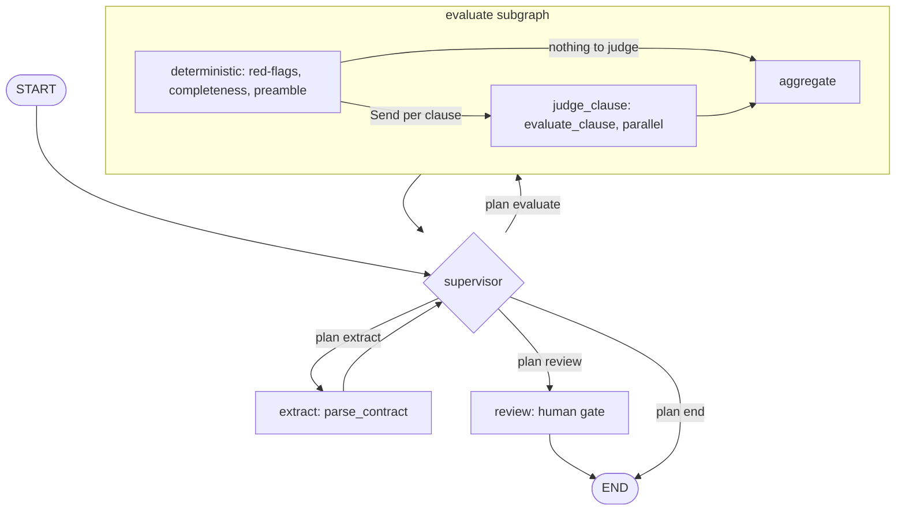

# Analysis workflow (LangGraph)

Đồ thị supervisor trong `app/agents/workflow.py`. Giải thích: [`../ARCHITECTURE.md`](../ARCHITECTURE.md).

Quy tắc của `_supervisor_node` theo thứ tự: chưa extract → `extract`; extract lỗi tạm thời và còn ngân sách retry → `extract` lại; có điều khoản và chưa evaluate → `evaluate`; còn lại, `review_mode` → `review`, ngược lại → `end`.

## Evidence
`app/agents/workflow.py`: `_build_extract_subgraph`, `_build_evaluate_subgraph`, `_build_review_subgraph`, `_supervisor_node`, `_route_by_plan`, `_fan_out`, `_deterministic_node`, `_judge_clause_node`, `_aggregate_node`, `_review_node`; cạnh `add_edge` / `add_conditional_edges` ở dòng 220-308.

## Giả định chưa xác minh
- Nhánh "nothing to judge" của `_fan_out` (`Send("aggregate", state)`, dòng ~250) suy từ một dòng; chưa đọc đầy đủ điều kiện.
- Cơ chế dừng/tiếp tục trong `_review_node` chưa được đọc nên chỉ vẽ là "human gate".
