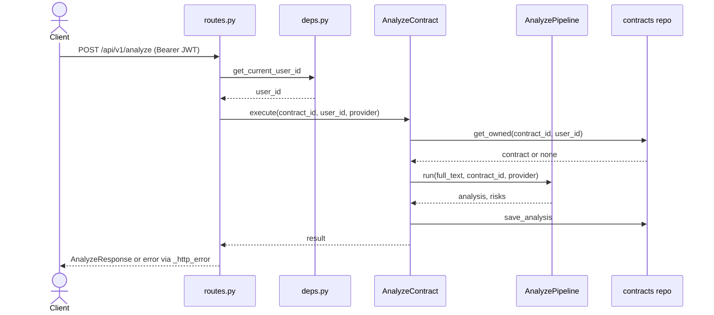
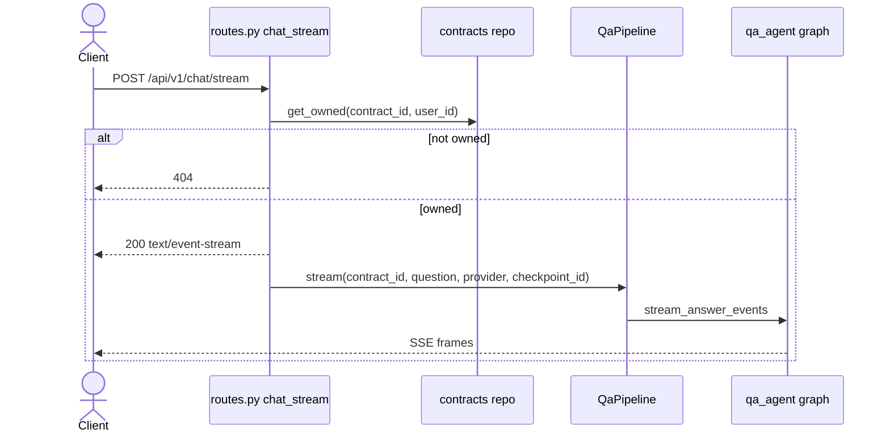

# API request lifecycle

Hai luồng đại diện: phân tích hợp đồng và chat streaming. Các route còn lại theo cùng khuôn (JWT → use case → repository). Ánh xạ route: [`../CODEBASE_MAP.md`](../CODEBASE_MAP.md).

## Evidence
- `app/api/routes.py`: `analyze`, `chat_stream`, `_http_error`; `app/api/deps.py`.
- `app/application/use_cases/contracts.py`: `AnalyzeContract.execute` (`get_owned`, `_pipeline.run` / `run_review`, `save_analysis`).
- `app/infrastructure/agents/pipelines.py`: `LangGraphQaPipeline.stream`.

## Giả định chưa xác minh
- Với `review_mode`, `AnalyzeContract` gọi `run_review` và trả bản nháp thay vì `save_analysis`; nhánh này không vẽ và chưa đọc hết thân hàm.
- Khuôn frame SSE nằm trong `stream_answer_events`, không vẽ ở đây.
- Trong luồng stream, tại route 404 xảy ra trước khi mở stream (đúng theo comment trong `chat_stream`).
