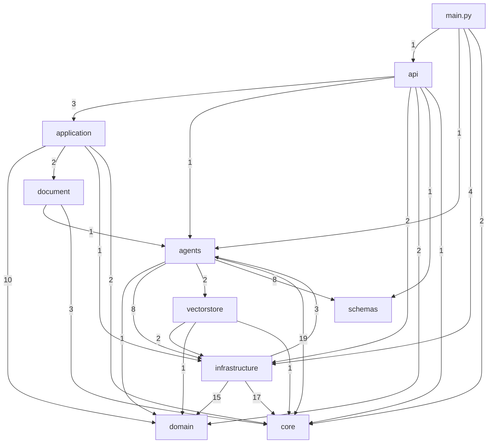

# Module dependency graph (cấp gói)

Số trên cạnh là số câu lệnh import khác nhau (kể cả import trong hàm) từ gói nguồn sang gói đích, đếm bằng script AST trên `app/`. `main` là `app/main.py`. Trailmark `diagram --type module-deps` trả về "No import edges found" cho `app/`, nên đồ thị này **không** do Trailmark sinh.

## Điểm đáng chú ý
- Không có import vòng ở mức module (kiểm tra bằng AST). Chu trình ở mức gói còn lại: `agents` ⇄ `infrastructure`, chỉ qua `infrastructure/agents/pipelines.py` (bọc đồ thị) và `agents` → `infrastructure/retrieval/*`; chủ đích.
- `domain` không import gói nào khác của `app`.
- `application` → `infrastructure` chỉ ở `legal_ingest.py` (`muc_luc_paths`).

## Evidence
Script AST duyệt `app/**/*.py`, đọc `import` / `from ... import` bắt đầu bằng `app.`. Chi tiết nợ phân lớp: [`../REFACTOR_PLAN.md`](../REFACTOR_PLAN.md).

## Giả định chưa xác minh
- Import động (`importlib`, `getattr`) không được tính.
- Số đếm là số câu lệnh import, không phải số symbol được dùng.
