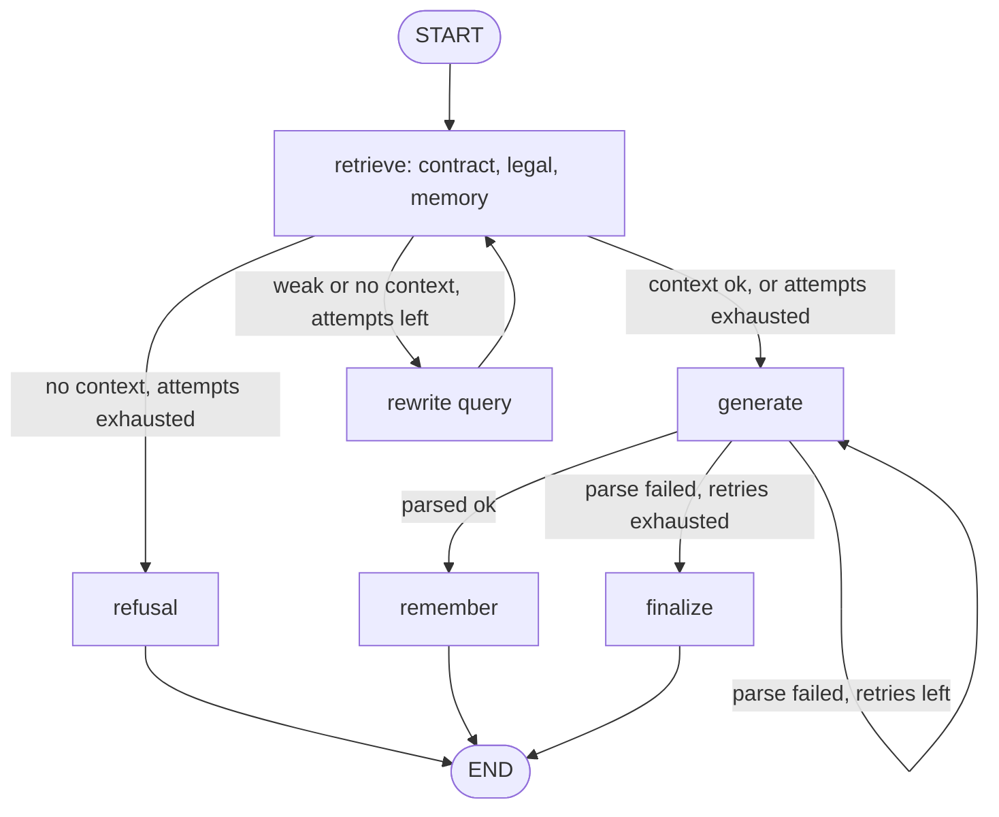

# QA workflow (LangGraph)

Đồ thị hỏi đáp trong `app/agents/qa_agent.py`.

## Evidence
`app/agents/qa_agent.py`: `_retrieve_node`, `_route_after_retrieve`, `_rewrite_query_node`, `_generate_node`, `_route_after_generate`, `_refusal_node`, `_remember_node`, `_finalize_node`; node và cạnh ở dòng 322-339. Ngưỡng điểm: `Settings.similarity_threshold`; giới hạn: `_MAX_RETRIEVAL_ATTEMPTS`, `_MAX_GENERATE_RETRIES`.

## Giả định chưa xác minh
- Giá trị cụ thể của hai hằng giới hạn chưa được ghi lại ở đây.
