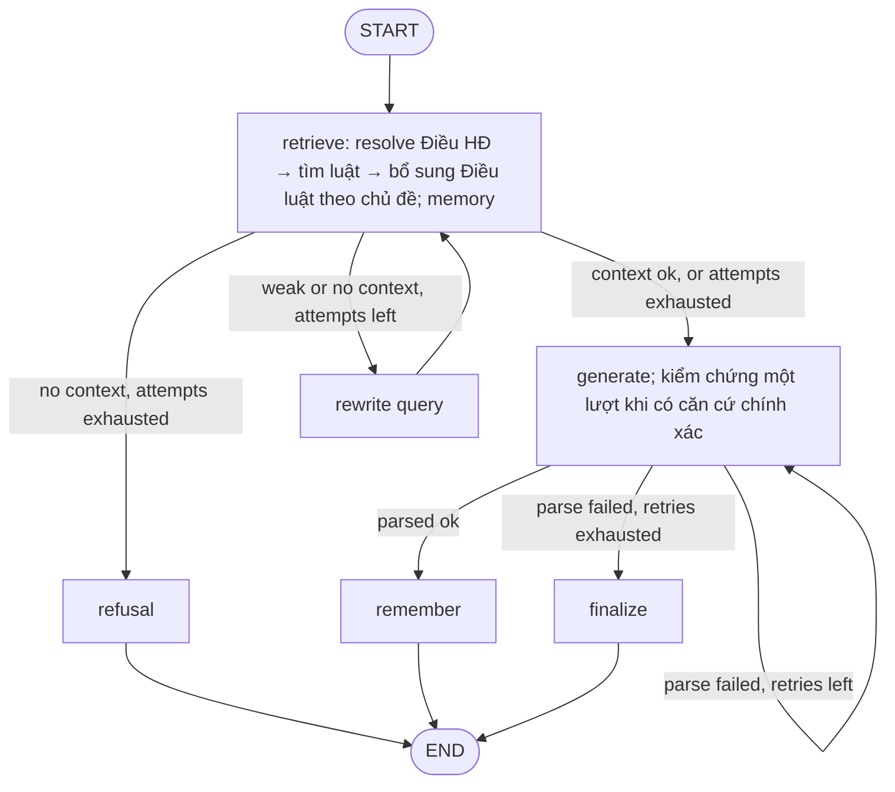

# QA workflow (LangGraph)

Đồ thị hỏi đáp trong `app/agents/qa_agent.py`.

## Evidence

Trong node `retrieve`, `_retrieve_contract_docs` ưu tiên Điều nêu trong câu hỏi qua `get_contract_chunks().get_text_by_clause` của đúng hợp đồng. `contract_clause_references` bỏ tham chiếu có tên văn bản luật; `ground_qa_retrieval_query` thêm nội dung Điều đã lấy được vào truy vấn luật. Câu không chỉ số Điều giữ truy vấn trước đó. Không thêm node/cạnh hoặc đổi retry/checkpointer; thí nghiệm trước/sau ở `evaluation/contract_eval_v2/README.md`.

Vòng v3: `qa_evidence.augment_legal_evidence` nhận diện chủ đề trong phạm vi lao động, tra chính xác Điều qua repository và ghép văn bản không lặp/tràn Điều kế tiếp. Dùng luật được resolver chọn theo ngày; ánh xạ số Điều 2019 không dùng cho luật đời trước. Khi có `topic_anchor`, không chèn thêm blurb cố định lệch chủ đề. `_legal_evidence` ghi metadata các nguồn thực để đánh giá; không thay schema/API. Prompt phân biệt thiếu dữ kiện với thiếu luật, còn `_verified_contract_citations` xác minh số Điều hợp đồng ở đầu ra.

V4: trong node `generate`, `_review_qa_result` dùng cùng model kiểm chứng bản nháp đúng một lần nếu có nguồn `topic_anchor`; lỗi kiểm chứng giữ bản nháp. Không thêm cạnh/retry/checkpointer hoặc lưu bản nháp vào lịch sử. Retrieval bổ sung Điều 1 để hiểu bối cảnh, ưu tiên chỉ căn cứ cốt lõi khi đã có; thêm nguyên tắc thỏa thuận và quyền tiếp cận Tòa án ở các chủ đề phù hợp. Phép đo/cost v4 ở `docs/bo_test_hoi_dong/CAI_THIEN_V4_KET_QUA.md`.
`app/agents/qa_agent.py`: `_retrieve_node`, `_route_after_retrieve`, `_rewrite_query_node`, `_generate_node`, `_route_after_generate`, `_refusal_node`, `_remember_node`, `_finalize_node`; node và cạnh ở `_graph_builder`. Ngưỡng điểm: `Settings.similarity_threshold`; giới hạn: `_MAX_RETRIEVAL_ATTEMPTS`, `_MAX_GENERATE_RETRIES`.

## Giả định chưa xác minh
- Giá trị cụ thể của hai hằng giới hạn chưa được ghi lại ở đây.
