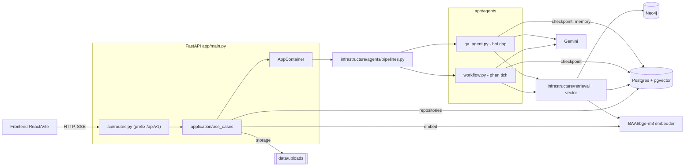

# System architecture

Thành phần runtime và các kết nối thật trong mã. Giải thích: [`../ARCHITECTURE.md`](../ARCHITECTURE.md).

## Evidence
- `app/main.py`: `lifespan` dựng `build_container()`, `LangGraphAnalyzePipeline`, `LangGraphQaPipeline`, `bind_retrieval`, `init_checkpointer`; `include_router(router)`; mount `frontend/dist`.
- `app/infrastructure/container.py`: `AppContainer` gồm repository Pg, `LocalObjectStorage`, `HuggingFaceEmbedder`, `GeminiChatModel`, `Neo4jGraphRepository`, `PgLegalVectorSearch`.
- `app/infrastructure/agents/pipelines.py`: import `qa_agent`, `workflow`.
- `app/agents/memory.py`: docstring ghi bộ nhớ dài hạn dùng `AsyncPostgresStore`.

## Giả định chưa xác minh
- Checkpointer lưu vào Postgres: suy từ `memory.py` và tên `init_checkpointer`; chưa đọc thân `checkpointer.py`.
- Frontend gọi API trực tiếp theo `VITE_API_BASE_URL`; chưa mở `frontend/src/api.js`.
- Luồng embed từ `UC` vẽ chung cho upload; truy vấn embed của retrieval vẽ riêng qua `RET`.
