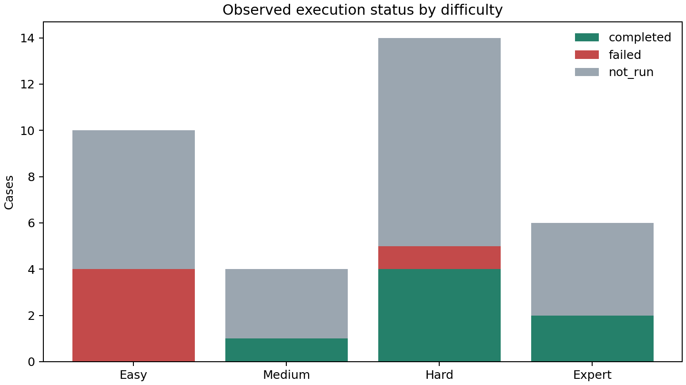
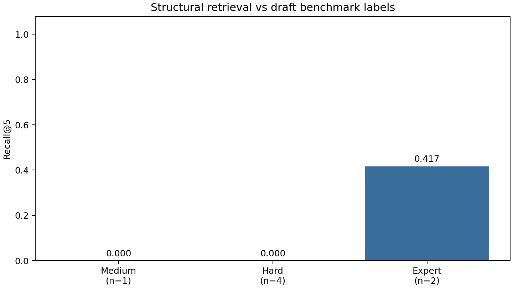

# ContractLens Mixed Temporal Legal Evaluation v0.4.1 — Baseline thực nghiệm

Cập nhật theo yêu cầu dừng Gemini: đã có RAG-only đủ 34 case, không gọi LLM, tại [rag_only/RAG_ONLY_REPORT.md](rag_only/RAG_ONLY_REPORT.md). Các kết quả generation bị quota bên dưới được giữ riêng.

Thời gian UTC: 2026-10-19T16:32:11.686186+00:00 → 2026-10-19T16:41:40.215839+00:00. Múi giờ người dùng: Asia/Bangkok (UTC+7).

Đã ghi trạng thái cho 34 case: thực thi hoàn tất 7, lỗi/bị ngắt 5, chưa chạy 22. Trong các output quan sát được, 3 case được đánh dấu capability chưa hỗ trợ; các nhóm này chồng với thực thi hoàn tất.
**Baseline chưa chạy đầy đủ do quota API. Các metric trên tập đã chạy không đại diện cho đủ 34 case.**
Nguyên nhân dừng: Worker stopped after confirmed provider daily quota exhaustion; remaining cases not run. Quota quan sát từ API: {'source': 'baseline_console.log and model_errors in raw predictions', 'metric': 'generate_content_free_tier_requests', 'quota_id': 'GenerateRequestsPerDayPerProjectPerModel-FreeTier', 'observed_limit': 20, 'interrupted_case': 'MIX-004'}.

## Phạm vi và độ tin cậy

Existing Corpus Baseline chạy trên bản sao vật lý của corpus PostgreSQL/Neo4j hiện có. Chỉ nạp hợp đồng DOCX đầu vào và tạo checkpoint trong bản sao; không ingest luật benchmark. Controlled Fixture Evaluation không chạy vì corpus luật fixture chưa được kiểm chứng độc lập.
34 case và căn cứ benchmark là synthetic draft. Điểm retrieval dưới đây chỉ đo so khớp cấu trúc với nhãn nháp; chưa phải độ chính xác tư vấn pháp luật. Các điểm answer correctness/faithfulness/hallucination chưa có chuyên gia hoặc judge hiệu chuẩn nên để null, không thay bằng similarity.

## Cấu hình và corpus

```json
{
  "gemini_model": "gemini-2.5-flash",
  "embedding_model": "BAAI/bge-m3",
  "embedding_dim": 1024,
  "embedding_device": "auto",
  "embedding_normalize": true,
  "embedding_max_seq_length": 512,
  "top_k_retrieval": 5,
  "similarity_threshold": 0.6,
  "legal_expand_backend": "neo4j",
  "provider": "gemini",
  "temperature": 0,
  "gemini_key_configured": true,
  "database_host": "postgres",
  "database_name": "contractlens",
  "llm_timeout_seconds": 120,
  "llm_sdk_max_retries": 0,
  "application_chat_completion_max_attempts": 3
}
```

Corpus: 137151 metadata văn bản; 21012 văn bản có chunk; 1004988 chunk. Kiểm tra fingerprint bảng luật trước/sau: **True**.
Metadata có thể là stub; số văn bản có chunk được báo cáo riêng. Định danh Điều=D, Khoản=K, Điểm=chữ trong ltree được chuẩn hóa bằng số hiệu văn bản, không so riêng portal doc_id. Chi tiết bảo vệ volume gốc và sự cố tên project Compose: ISOLATION_AND_EXECUTION_NOTES.md.

## Theo độ khó

| Nhóm | Tổng | Hoàn tất | Lỗi | Chưa chạy | Unsupported | Recall@5 (n) |
|---|---:|---:|---:|---:|---:|---:|
| Easy | 10 | 0 | 4 | 6 | 0 | N/A (0) |
| Medium | 4 | 1 | 0 | 3 | 0 | 0.000 (1) |
| Hard | 14 | 4 | 1 | 9 | 1 | 0.000 (4) |
| Expert | 6 | 2 | 0 | 4 | 2 | 0.417 (2) |

## Theo nhiệm vụ

| Task | Tổng | Hoàn tất | Lỗi | Chưa chạy |
|---|---:|---:|---:|---:|
| classification | 1 | 0 | 0 | 1 |
| multi_hop | 7 | 3 | 0 | 4 |
| qa | 13 | 4 | 0 | 9 |
| risk | 13 | 0 | 5 | 8 |

## Retrieval và GraphRAG

| Stage | n | Recall@1 | Recall@3 | Recall@5 | Recall@10 | MRR | Exact provision recall |
|---|---:|---:|---:|---:|---:|---:|---:|
| seed | 7 | 0.000 | 0.000 | 0.048 | 0.048 | 0.036 | 0.048 |
| graph_expanded_ranked | 7 | 0.000 | 0.119 | 0.119 | 0.119 | 0.119 | 0.119 |
| final_retrieval | 7 | 0.000 | 0.119 | 0.119 | 0.119 | 0.119 | 0.119 |
| confirmed_full_chunks_in_llm_context | 7 | 0.000 | 0.119 | 0.119 | 0.119 | 0.119 | 0.119 |

Seed là các seed path thực tế đưa vào graph. Graph-expanded là danh sách đã mở rộng và xếp hạng trước lọc/truncate cuối. Final retrieval là các chunk trả về. Context stage chỉ đếm full chunk có mặt trong prompt thực tế; raw prompt được lưu trong trace. Citations trong output được giữ riêng.
Precision/nDCG theo pooled qrels chỉ là chẩn đoán mở rộng trong RETRIEVAL_METRICS.json; corpus thật có chunk chưa được gán relevance nên không tuyên bố đó là precision đầy đủ. Relation Edge Recall để null vì pipeline không expose các edge ID đã dùng.

## Chất lượng đáp án và rủi ro

Có 11 output sinh hoặc fallback; 0 case đã được con người thẩm định. Xem ANSWER_RUBRIC.md và HUMAN_REVIEW_TEMPLATE.csv.
Severity: 0/11 case có nhãn gold và output so sánh được; accuracy điều kiện=N/A. Critical Risk Recall=N/A (n=0). Các output thiếu/lỗi không bị ép thành nhãn ok hoặc false negative.
Chỉ dùng nhãn critical/warning/ok. Không suy ra ok từ kết quả workflow rỗng hoặc từ judge bị lỗi.

## Temporal Legal RAG

Nhóm temporal gồm 14 case; trạng thái capability: {'unsupported_capability': 3, 'not_run': 11}. Output pipeline hiện tại vẫn được lưu để phân tích.
QA chuẩn không forward as_of_date/transaction_date vào retrieve_legal; vector search loại c.is_effective=false và document status_flag=2 trước khi ranking theo thời gian. Risk workflow cũng không nhận hai ngày này. Vì vậy chưa có chứng cứ hỗ trợ time-travel retrieval hay quy định chuyển tiếp đầy đủ.
Không đồng nhất hết hiệu lực chung với không được áp dụng trong ngoại lệ chuyển tiếp. Temporal Version Accuracy, Applicable Law Selection, Outdated Citation Rate và Transitional Accuracy chưa được chấm pháp lý.

## Các lỗi quan sát được

- Invalid/Unverified Ground Truth: 34 case.
- Pipeline Execution Failure: 5 case.
- Unsupported Capability: 3 case.
- Retrieval Missing Evidence: 7 case.
- Wrong Legal Document: 5 case.
- Environment/Dependency Block: 22 case.

## Hạn chế benchmark

- Tất cả case synthetic draft; kiểm tra schema không xác nhận tính đúng pháp lý.
- Status manifest thiếu các luật được provision tham chiếu: 36/2005/QH11, 84/2015/QH13, 91/2015/QH13.
- Ba snapshot N145 chưa có toàn văn kiểm chứng; các sửa đổi sau 2024 chưa được map đầy đủ.
- Gold risk_severity chỉ có ở 11 case; hai temporal risk không đủ nhãn severity để ép tính classifier metric.
- Qrels chỉ bao phủ một tập provision nhỏ, không gán relevance đầy đủ cho corpus thật. Ground truth citations không phải toàn văn mọi điều luật.
- Các file .txt được manifest khai báo không tồn tại; DOCX là đầu vào thực tế. Text/span trên embedded reference có thể khác header của DOCX.

## Ưu tiên cải tiến sau baseline

1. Khôi phục quota model hiện tại để chạy tập đầy đủ. Sửa contract extraction/validation để xử lý tên bên chưa được cung cấp và phân biệt lỗi workflow với kết quả không có rủi ro; thêm đo độ bao phủ điều khoản đã thực sự được đánh giá.
2. Rà soát parser/chunker cho Mục/Điều và cơ chế kiểm tra citations; giữ đúng định danh điều khoản của hợp đồng synthetic.
3. Rà soát hiệu lực cấp điều khoản: BLLĐ 2019/NĐ145 có status_flag=4 nhưng toàn bộ chunk is_effective=false; Luật BHXH 2024 trong DB có eff_to=2026-01-01/status=2, khác draft benchmark. Cần đối chiếu nguồn chính thức, không tự sửa nhãn. Rà soát hardcode Hợp đồng lao động trong QA đa lĩnh vực và corpus Luật Thương mại còn thiếu.
4. Thiết kế retrieval theo phiên bản và thời điểm, quan hệ có phạm vi Điều/Khoản/Điểm, cùng logic chuyển tiếp; bổ sung logging edge thực dùng.
5. Thẩm định gold với chuyên gia pháp luật, hoàn thiện snapshot lịch sử và relevance judgments; sau đó mới dùng tập khác để tuning và chạy lại đánh giá.




