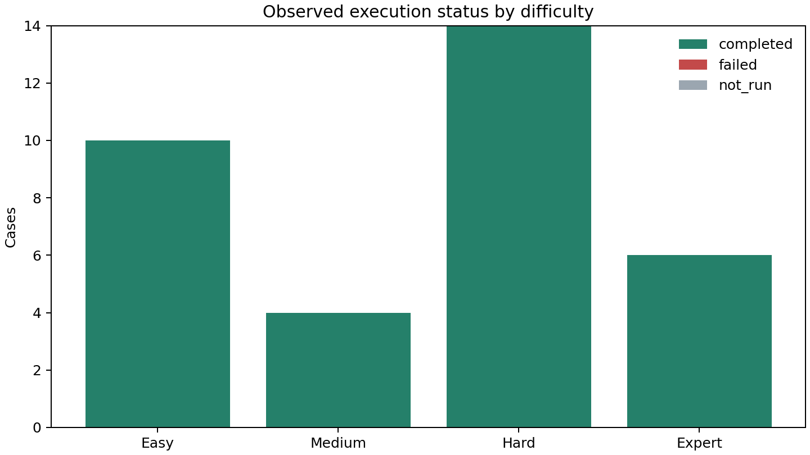
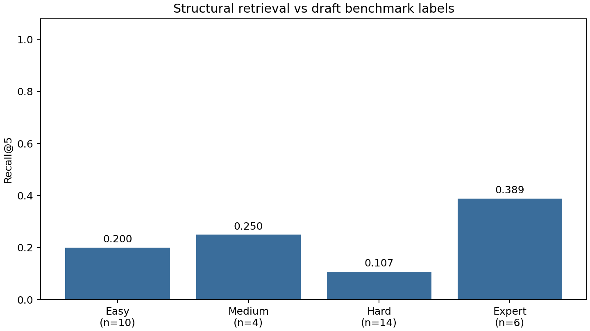

# ContractLens RAG-only — Existing Corpus Baseline

Đã chạy retrieval cho **34/34 case**. Trạng thái: {'completed': 34}. **0 lượt gọi Gemini; không sinh đáp án/citations LLM.**

Thời gian UTC: 2026-11-05T10:54:00.572390+00:00 → 2026-11-05T10:55:41.956130+00:00. Corpus luật fingerprint trước/sau giống nhau: **True**.
Gemini credential trong worker: False. LLM client modules loaded: [].

## Phương pháp

Chỉ QUESTIONS_ONLY_NO_GOLD được dùng khi truy xuất. BGE-M3 được đọc từ cache cục bộ; PostgreSQL/Neo4j dùng corpus hiện có trong bản sao. Không ingest luật fixture, sửa cờ hiệu lực, thêm căn cứ gold hay tuning Top-K.
QA/multi-hop/classification chạy first-pass retrieve_legal như QA hiện tại (k=5, không gán cứng contract_type). Risk chạy LegalGraphRag.retrieve_for_clause với question/scenario đầu vào (k_seed=4, max_total=10); không thực hiện LLM clause extraction. Đây là đánh giá retrieval theo fact pattern, không phải đánh giá rủi ro hợp đồng đầu-cuối.
7 DOCX được parse/chunk/embed bằng UploadContract thực tế trong database bản sao; contract retrieval được lưu riêng với legal retrieval. Gold được đọc sau khi hoàn tất toàn bộ retrieval.

## Kết quả theo stage

| Stage | n | R@1 | R@3 | R@5 | R@10 | MRR | Provision coverage |
|---|---:|---:|---:|---:|---:|---:|---:|
| seed | 34 | 0.142 | 0.191 | 0.201 | 0.201 | 0.260 | 0.201 |
| graph_expanded_ranked | 34 | 0.142 | 0.191 | 0.201 | 0.201 | 0.260 | 0.201 |
| final_retrieval | 34 | 0.142 | 0.191 | 0.201 | 0.201 | 0.260 | 0.201 |

Seed là seed path thực tế đưa vào graph. Graph-expanded ranked được ghi trước lọc/truncation cuối; final retrieval là chunk được trả về. Không có final context gửi LLM hoặc cited chunks trong lần chạy này.
Hiệu ứng graph trên provision coverage: {'paired_cases': 34, 'improved_coverage': 0, 'reduced_coverage': 0, 'unchanged_coverage': 34, 'mean_coverage_change': 0.0}.

## Theo độ khó và nhiệm vụ

| Nhóm | n | Final R@5 | Final provision coverage |
|---|---:|---:|---:|
| easy | 10 | 0.200 | 0.200 |
| medium | 4 | 0.250 | 0.250 |
| hard | 14 | 0.107 | 0.107 |
| expert | 6 | 0.389 | 0.389 |
| classification | 1 | 0.000 | 0.000 |
| multi_hop | 7 | 0.262 | 0.262 |
| qa | 13 | 0.192 | 0.192 |
| risk | 13 | 0.192 | 0.192 |

## Contract retrieval

Text-span coverage: {'value': 1.0, 'sample_count': 20}; exact clause ID: {'value': 1.0, 'sample_count': 20}.
Đây là hai metric khác nhau: tìm thấy toàn bộ text hợp đồng trong một chunk không có nghĩa parser nhận đúng Điều/Mục. Các heading dạng Điều 1 xuống dòng hoặc Mục A không phù hợp regex yêu cầu dấu câu của pipeline hiện tại.

## Giới hạn và lỗi cần ưu tiên

- Ground truth synthetic draft chưa được chuyên gia xác minh. Các score là cấu trúc so với nhãn nháp, không chứng minh câu trả lời pháp luật đúng.
- Corpus có BLLĐ 2019/NĐ145 nhưng tất cả chunk của các văn bản này đang is_effective=false. Các chunk bị loại ngay ở seed SQL. Luật Thương mại 36/2005/QH11 chưa có trong corpus được tìm thấy. Chi tiết ở báo cáo corpus coverage cấp trên.
- Corpus BHXH 2024 có eff_to/status khác metadata nháp của benchmark; cần đối chiếu nguồn chính thức, chưa tự sửa bên nào.
- 14 case temporal chỉ có structural retrieval diagnostic. Không có time-travel retrieval được xác nhận; không đánh đồng luật hết hiệu lực chung với không áp dụng chuyển tiếp.
- Precision/nDCG pooled có trong JSON và được ghi rõ giả định unjudged=nonrelevant; không phải precision có đánh giá relevance đầy đủ. Exact identity không kiểm chứng lịch sử phiên bản.
- Relation Edge Recall để null: graph có cạnh không chứng minh cạnh đã được pipeline dùng.
- Đề xuất sau baseline: kiểm tra hiệu lực cấp điều khoản và thiếu corpus, cải thiện parser/chunker, routing domain QA và observability edge; sau đó mới triển khai temporal retrieval. Lần chạy này không thay các thuật toán đó.

Full required-provision coverage: 3/34 case. Đây là structural pass, không phải pass nội dung pháp lý.

Coverage tăng không đồng nghĩa ranking tốt hơn: so sánh Recall@1 và MRR ở bảng stage; graph expansion có thể thay đổi thứ tự hoặc đẩy evidence xuống dưới. Không kết luận GraphRAG cải thiện toàn diện từ một metric.

Chi tiết lỗi từng case: ERROR_ANALYSIS.md. Corpus coverage: ../CORPUS_COVERAGE_REPORT.md.
